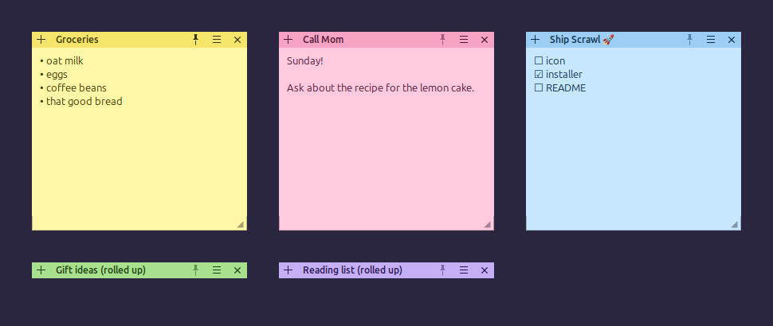

# Scrawl

Simple sticky notes for your Linux desktop. Each note is its own window you can drag, resize, recolor and pin on top. Everything saves automatically.



## Features

- Unlimited notes, each in its own borderless window
- Name your notes with a title, and double-click the header to roll a note up to just its title bar
- Snaps to screen edges and corners (no accidental full-screen tiling)
- 7 pastel colors and adjustable text size
- "Keep on top" pin
- Auto-saves text, title, position, size, color, pin and rolled-up state, and saves instantly on logout or shutdown
- Single instance: launching again brings your notes forward
- Optional start at login

## Install

Requires Python 3 and GTK 3 (preinstalled on Ubuntu desktop). If missing:

```bash
sudo apt install python3 python3-gi gir1.2-gtk-3.0
```

Then:

```bash
git clone https://github.com/webhookstudios/scrawl && cd scrawl
./install.sh              # app menu + `scrawl` command
./install.sh --autostart  # ...and start at login
```

Keep the folder in place: the `scrawl` command links to `scrawl.py`.

## Use

| Action | How |
| --- | --- |
| New note | `+` button, `Ctrl+N`, or `scrawl --new` |
| Move | Drag the colored header; notes snap to screen edges and corners |
| Name a note | Click "Title" in the header (or right-click the header), type, press Enter |
| Roll up / unroll | Double-click the header |
| Resize | Drag the ◢ corner |
| Color / text size | ☰ menu |
| Delete note | ✕ button or `Ctrl+W` (asks first if it has text) |

Tip: bind `scrawl --new` to a shortcut in Settings → Keyboard → Custom Shortcuts.

## Troubleshooting

**Scrawl shows up in search but not in the Show Applications grid (GNOME).** GNOME keeps a saved grid layout and doesn't always add new apps to it. Either reset the grid (this clears any custom ordering):

```bash
gsettings reset org.gnome.shell app-picker-layout
```

or pin Scrawl to the dock from the search results (right-click, then Pin to Dock).

## Uninstall

```bash
./uninstall.sh          # keeps your notes
./uninstall.sh --purge  # also deletes them
```

Notes live in `~/.local/share/scrawl/notes.json`.

## Notes on Wayland

Wayland doesn't let apps position their own windows, so Scrawl runs through XWayland (`GDK_BACKEND=x11`). That's what lets notes remember where you put them.

## License

MIT
